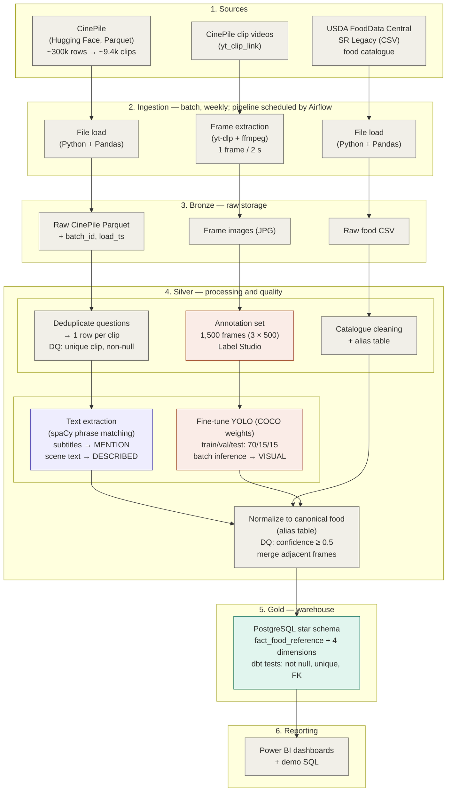

# Tasty Screen

Tasty Screen is a data-modeling project for analysing food references in movies. It brings together food mentioned in subtitles, described in scenes, and detected in video frames within a PostgreSQL star schema.

This repository currently contains the database schema, illustrative sample data, and analytical SQL queries created for the Data Architecture & Modeling project.

## Repository contents

```text
.
├── README.md
└── sql/
    ├── 01_ddl_star_schema.sql
    ├── 02_dml_sample_data.sql
    └── 03_business_queries.sql
```

| File | Description |
|---|---|
| `sql/01_ddl_star_schema.sql` | Creates the PostgreSQL fact and dimension tables, constraints, and indexes |
| `sql/02_dml_sample_data.sql` | Inserts fictional sample records for testing and demonstration |
| `sql/03_business_queries.sql` | Runs seven example analytical queries and one model-version comparison |

## Proposed architecture

The architecture has three paths: CinePile text produces `MENTION` and `DESCRIBED` evidence, the USDA catalogue provides canonical foods and aliases, and clip frames produce `VISUAL` evidence. The paths converge during normalization before loading the analytical model.



Airflow, dbt, visual-model training, and Power BI are proposed parts of the complete platform; this repository currently implements only the SQL model and demonstration queries.

## Data model

The star schema uses `fact_food_reference` as its central table and contains four dimensions:

- `dim_movie`
- `dim_scene`
- `dim_food`
- `dim_detection_method`

Each fact row represents one canonical food in one scene, for one evidence type and one detection-method version. The supported evidence types are:

- `MENTION` — found in subtitles
- `DESCRIBED` — found in the scene description
- `VISUAL` — detected in video frames

Repeated references at the same grain are stored in `occurrence_count`. Detection methods are versioned so that results remain reproducible when a text matcher or visual model changes.

## Requirements

- PostgreSQL
- The `psql` command-line client

## Running the SQL

### Command line

Create a database and execute the files in order from the repository root:

```bash
createdb tasty_screen
psql -v ON_ERROR_STOP=1 -d tasty_screen -f sql/01_ddl_star_schema.sql
psql -v ON_ERROR_STOP=1 -d tasty_screen -f sql/02_dml_sample_data.sql
psql -v ON_ERROR_STOP=1 -d tasty_screen -f sql/03_business_queries.sql
```

### pgAdmin

The scripts can also be run through the pgAdmin interface:

1. Create a database named `tasty_screen`.
2. Select the database and open **Tools → Query Tool**.
3. Open and execute each SQL file in this order:
   1. `sql/01_ddl_star_schema.sql`
   2. `sql/02_dml_sample_data.sql`
   3. `sql/03_business_queries.sql`

Run each file completely before opening the next one. Query results from the final script appear in pgAdmin's **Data Output** panel.

The DDL script drops and recreates the five model tables. Do not run it against a database containing data you need to preserve.

The sample rows are fictional and exist only to demonstrate the schema and produce results from the example queries.

## Included analyses

The queries examine:

1. Food categories most often shown on screen
2. Foods most often mentioned in dialogue
3. Foods both mentioned and shown in the same scene
4. Food-reference rates by movie genre
5. Food categories appearing across the widest range of genres
6. Movies containing the most food references
7. Visual appearances of beverages compared with solid food

An additional query compares results produced by different detector versions.

## Data sources

The proposed full platform uses:

- [CinePile](https://huggingface.co/datasets/tomg-group-umd/cinepile) for movie, clip, subtitle, and scene-description data
- [USDA FoodData Central — SR Legacy](https://fdc.nal.usda.gov/download-datasets) as the canonical food catalogue
- A group-created frame-annotation set for the proposed visual food detector

Source datasets and movie frames are not included in this repository.
