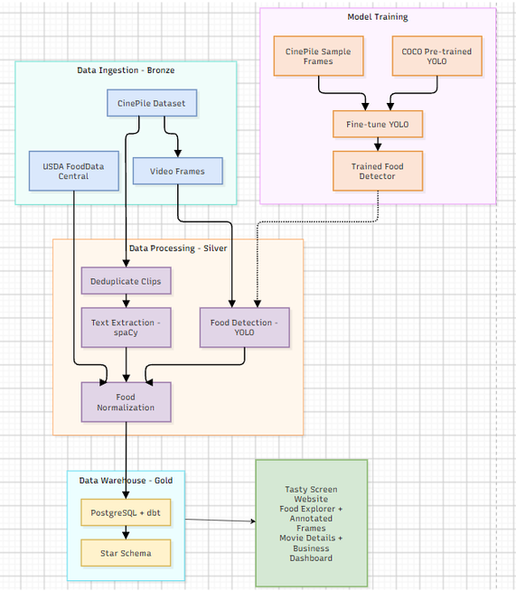
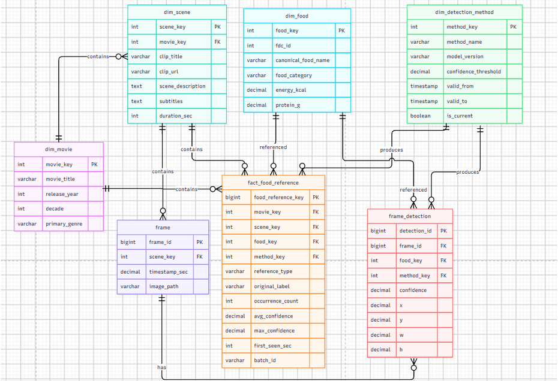

# Tasty Screen

Tasty Screen is a data-modeling project for analyzing food references in movies. It brings together food mentioned in subtitles, described in scenes, and detected in video frames within a PostgreSQL star schema.

The main project covers the data engineering pipeline, PostgreSQL analytical model, and project results. It currently implements the schema, illustrative sample data, analytical SQL queries, a dbt view, and an Airflow demo workflow. Automated source ingestion and reporting are still planned.

Model training, annotation, detector evaluation, and vision-specific setup live in [`vision/`](vision/README.md).

## Repository contents

```text
.
├── .env.example
├── .dockerignore
├── compose.yaml
├── Dockerfile
├── README.md
├── requirements.txt
├── airflow/
│   ├── Dockerfile
│   ├── README.md
│   └── dags/warehouse_demo.py
├── dbt/
│   ├── dbt_project.yml
│   ├── profiles.yml
│   └── models/
├── scripts/check_warehouse.py
├── docs/
│   ├── architecture.png
│   ├── star_schema.png
│   └── data_dictionary.md
├── sql/
│   ├── 01_ddl_star_schema.sql
│   ├── 02_dml_sample_data.sql
│   └── 03_business_queries.sql
└── vision/
    ├── README.md
    ├── compose.yaml
    ├── .env.example
    ├── .dockerignore
    ├── .gitignore
    ├── Dockerfile
    ├── requirements.txt
    └── configs/
        ├── dataset.yaml
        └── train.yaml
```

| File | Description |
|---|---|
| `compose.yaml` | Runs the Python environment, warehouse PostgreSQL, local Airflow, and a separate Airflow metadata PostgreSQL |
| `Dockerfile` | Builds the Python 3.12 data engineering development image |
| `.dockerignore` | Excludes credentials, local environments, and datasets from image builds |
| `.env.example` | Example local database credentials and host port |
| `requirements.txt` | Pinned Python dependencies for ingestion, text matching, video downloads, and dbt |
| `airflow/` | Airflow image and a paused weekly warehouse/dbt demo workflow |
| `dbt/` | PostgreSQL profile and the `analytics.current_food_references` view |
| `scripts/check_warehouse.py` | Reads warehouse table counts using the standard PostgreSQL environment variables |
| `vision/` | Independent model-training project with its own Compose file, Dockerfile, dependencies, and configuration |
| `sql/01_ddl_star_schema.sql` | Creates the PostgreSQL fact and dimension tables, constraints, and indexes |
| `sql/02_dml_sample_data.sql` | Inserts fictional sample records for testing and demonstration |
| `sql/03_business_queries.sql` | Runs seven example analytical queries |

## Proposed architecture

The architecture has three paths: CinePile text produces `MENTION` and `DESCRIBED` evidence, the USDA catalogue provides canonical foods and aliases, and clip frames produce `VISUAL` evidence. The paths converge during normalization before loading the analytical model.



- **Bronze** — data exactly as downloaded (CinePile Parquet, SR Legacy CSV, frames), never modified.
- **Silver** — cleaned and processed: one row per clip, food found in text (`MENTION`, `DESCRIBED`) and in frames (`VISUAL`), normalised to canonical foods, with quality checks.
- **Gold** — star schema in PostgreSQL, built and tested with dbt, read by PowerBI.

In the proposed platform, a weekly **Airflow** DAG runs every step in order, services run in **Docker Compose**, and the detector is fine-tuned on a **Google Colab** GPU. The root Compose configuration provides the warehouse database, Python development tools, and local Airflow with its own metadata database. Model training runs independently using `vision/compose.yaml`.

> The Airflow demo checks the existing warehouse and builds a dbt view. Full ingestion/normalization, detector training, and Power BI reporting remain to be implemented.

## Data engineering scope

The pipeline will ingest CinePile and USDA data, retain raw source records, extract food references from text, and normalize both text evidence and the versioned detections supplied by the vision workspace. It will apply quality checks, aggregate references to the scene/food/evidence/method grain, and load the PostgreSQL dimensions and fact table.

The SQL model, example queries, a dbt view, and a paused weekly Airflow demo are implemented. Automated ingestion, detection-output loading, comprehensive warehouse transformations/tests, and dashboards still need implementation. The [vision handoff](vision/README.md#handoff-to-the-data-engineering-pipeline) describes the proposed detection records and the pipeline's responsibility for turning frame detections into scene-level facts.

## Data model



The star schema uses `fact_food_reference` as its central table and contains four dimensions:

- `dim_movie`
- `dim_scene`
- `dim_food`
- `dim_detection_method`

**Grain of `fact_food_reference`:** Each fact row represents one canonical food in one scene, for one evidence type and one detection-method version. The supported evidence types are:

- `MENTION` — found in subtitles
- `DESCRIBED` — found in the scene description
- `VISUAL` — detected in video frames

Repeated references at the same grain are stored in `occurrence_count`. Detection methods are versioned so that results remain reproducible when a text matcher or visual model changes.

## Requirements

- Docker Engine or Docker Desktop with Docker Compose v2 for the container setup below. Python, PostgreSQL, and Python libraries are installed inside containers; no host installations are required.
- Alternatively, PostgreSQL and the `psql` command-line client for the manual setup.

### Python dependencies and exact versions

The Dockerfile uses the [official Python image](https://hub.docker.com/_/python), with Python **3.12.16** on Debian Bookworm. The development image installs the pipeline libraries, FFmpeg, and Deno for video processing and YouTube JavaScript challenges. Airflow uses its own official image and installs the same pipeline tools in a separate virtual environment.

Data engineering dependencies are listed directly in `requirements.txt` with exact versions. Docker installs them with pip, which resolves their indirect dependencies automatically; this is not a complete lockfile. Training dependencies are maintained separately in [`vision/requirements.txt`](vision/requirements.txt).

| Package | Use in the planned pipeline |
|---|---|
| [`huggingface-hub`](https://huggingface.co/docs/huggingface_hub/guides/download) | Download CinePile source files from Hugging Face |
| `pandas` | Clean and transform tabular data and read USDA CSV files |
| `pyarrow` | Read CinePile Parquet files, including through pandas |
| `psycopg[binary]` | Query PostgreSQL and load rows from Python |
| [`python-dotenv`](https://pypi.org/project/python-dotenv/) | Read local connection settings from `.env` |
| `spacy` | Tokenize subtitles/descriptions and match food aliases with `PhraseMatcher` |
| `yt-dlp[default]` | Download source videos, with the YouTube challenge solver included |
| `dbt-core` / `dbt-postgres` | Build PostgreSQL analytical views and future warehouse transformations |

For basic phrase matching, `spacy.blank("en")` provides a tokenizer without downloading a trained language model.

Airflow **3.3.2** is installed through `apache/airflow:3.3.2-python3.12`, not through the root requirements. Its pipeline tasks use an isolated virtual environment so the pipeline libraries do not change Airflow's own dependencies. Label Studio is not installed; annotation setup belongs to the independent vision project.

## Running with Docker

Run these commands from the repository root:

```bash
cp .env.example .env
# Edit .env to choose your local database password.
docker compose up -d --build --wait
```

If `.env` already exists, edit it instead of copying over it. On Linux/WSL, set `LOCAL_UID` and `LOCAL_GID` in `.env` to the output of `id -u` and `id -g` if they differ from 1000. This makes files created in the mounted project folder belong to your local user.

Compose starts four services: `python`, warehouse `postgres`, `airflow`, and metadata `airflow-postgres`. Airflow runs in [standalone development mode](https://airflow.apache.org/docs/apache-airflow/3.3.2/start.html), starting its scheduler, DAG processor, API server, and triggerer in one container. The Python service waits for the warehouse; Airflow waits for both databases. `--wait` waits for the configured health checks. Allow extra time and memory for the first Airflow startup.

The setup is for local development. Airflow is exposed only on localhost at `http://localhost:8080` (or `AIRFLOW_PORT` from `.env`). It automatically initializes its metadata database. See [Airflow setup and login](airflow/README.md) for the generated admin password and workflow commands. If `.env` predates this setup, the Airflow settings use the defaults from `.env.example` until you add them.

On the first startup, PostgreSQL runs `01_ddl_star_schema.sql` followed by `02_dml_sample_data.sql`. The database contains 3 movies, 4 scenes, 5 foods, 4 detection methods, and 11 food-reference rows.

### Work in the Python container

Open Python, open a shell, or check the installed dependencies:

```bash
docker compose exec python python
docker compose exec python bash
docker compose exec python python -m pip check
```

Exit Python or Bash before running the next command. The project is mounted at `/workspace`, so edits in your IDE are immediately available inside the container and files you create there appear in your project. The container stays running for interactive development; it does not automatically execute a pipeline.

Compose sets the standard PostgreSQL connection variables (`PGHOST=postgres`, `PGPORT=5432`, `PGDATABASE`, `PGUSER`, and `PGPASSWORD`) in the Python service. To verify the connection and sample data without installing a host client:

```bash
docker compose exec python python -c 'import psycopg; conn = psycopg.connect(); print(conn.execute("SELECT COUNT(*) FROM fact_food_reference").fetchone()[0]); conn.close()'
```

This prints `11` for the initial demo data. Inside Docker, use the service name `postgres` and port `5432`; the host port setting in `.env` is for clients outside Docker.

The [vision project](vision/README.md) has its own Compose stack, dependencies, and setup. Root startup includes the data engineering and Airflow services; it does not build, start, or configure vision services.

### Download videos and extract frames

The development container includes [yt-dlp](https://github.com/yt-dlp/yt-dlp#installation), its JavaScript challenge solver, Deno, FFmpeg, and FFprobe. `yt_clip_link` is source metadata rather than a Python package. To download an individual source video, replace the URL placeholder:

```bash
docker compose exec python yt-dlp --no-playlist --write-info-json -o 'data/bronze/videos/%(id)s.%(ext)s' 'YOUTUBE_URL'
```

Preserve the CinePile clip boundaries and original metadata when processing a downloaded video; a parent video URL alone does not identify the clip's start/end timestamps. Batch ingestion, retries, and source-to-clip manifests are still to be implemented. FFmpeg can extract frames from a local clip after creating its output directory:

```bash
docker compose exec python mkdir -p frames/clip_001
docker compose exec python ffmpeg -i data/bronze/videos/clip_001.mp4 -vf fps=1 frames/clip_001/frame_%06d.jpg
```

Replace the example input filename with your actual local clip. These commands run only when you invoke them; Docker startup does not download videos.

### Build the dbt analytical view

The tracked dbt profile reads the same `PG*` environment variables as Python. It writes to the separate `analytics` schema, leaving the SQL-managed tables in `public`:

```bash
docker compose exec python dbt debug --project-dir dbt --profiles-dir dbt
docker compose exec python dbt build --project-dir dbt --profiles-dir dbt
```

The first model, `analytics.current_food_references`, joins food and method metadata to fact rows and filters to current method versions. It contains 10 rows with the initial sample data. The rest of the warehouse transformations and data tests still need implementation.

### Update dependencies

Edit the versions directly in `requirements.txt`, then rebuild:

```bash
docker compose up -d --build --wait
```

The Dockerfile runs `pip check` during each image build. Vision dependencies are updated separately using the instructions in `vision/README.md`.

### Query the database

Open an interactive SQL session:

```bash
docker compose exec postgres sh -c 'psql -U "$POSTGRES_USER" -d "$POSTGRES_DB"'
```

For pgAdmin or another host client, connect to `127.0.0.1`, port `5432`, database `tasty_screen`, and user `tasty_screen`, using the password in `.env`. If you change the port, database, or user in `.env`, use those values instead. Containers on the Compose network connect to `postgres:5432`.

The port is bound to localhost. The example credentials are for local development, and `.env` is ignored by Git. If port 5432 is occupied, set `POSTGRES_PORT=5433` in `.env` before starting.

### Status, logs, and stopping

```bash
docker compose ps
docker compose logs -f postgres
docker compose down
```

The independent vision stack is stopped separately by running `docker compose down` from `vision/`.

`docker compose down` keeps the warehouse `postgres_data` volume, Airflow metadata `airflow_postgres_data`, and Airflow logs/configuration/login state in `airflow_home`. Starting the service again reuses the data; initialization scripts run only when the volume is empty. Changing SQL files or credentials in `.env` does not update an existing database automatically.

### Resetting the demo database

The following commands **delete the warehouse data, Airflow metadata/history, and Airflow logs/configuration/login state**. They then reinitialize both databases and reload the warehouse schema and samples:

```bash
docker compose down --volumes
docker compose up -d --build --wait
```

If initialization fails, inspect `docker compose logs postgres` and fix the cause before resetting the demo volume. A partially initialized volume will not automatically rerun the scripts.

On WSL 2, if `docker --version` reports that Docker is unavailable, start Docker Desktop and enable **Settings → Resources → WSL Integration** for your distribution. Confirm that both `docker --version` and `docker compose version` work before running the commands above.

## Running the SQL

### Command line

Create a database and execute the files in order from the repository root:

```bash
createdb tasty_screen
psql -v ON_ERROR_STOP=1 -d tasty_screen -f sql/01_ddl_star_schema.sql
psql -v ON_ERROR_STOP=1 -d tasty_screen -f sql/02_dml_sample_data.sql
psql -v ON_ERROR_STOP=1 -d tasty_screen -f sql/03_business_queries.sql
```

### pgAdmin

The scripts can also be run through the pgAdmin interface:

1. Create a database named `tasty_screen`.
2. Select the database and open **Tools → Query Tool**.
3. Open and execute each SQL file in this order:
   1. `sql/01_ddl_star_schema.sql`
   2. `sql/02_dml_sample_data.sql`
   3. `sql/03_business_queries.sql`

Run each file completely before opening the next one. Query results from the final script appear in pgAdmin's **Data Output** panel.

The DDL script drops and recreates the five model tables. Do not run it against a database containing data you need to preserve.

The sample rows are fictional and exist only to demonstrate the schema and produce results from the example queries.

## Business Questions

The queries examine:

1. Food categories most often shown on screen
2. Foods most often mentioned in dialogue
3. Foods both mentioned and shown in the same scene
4. Food-reference rates by movie genre
5. Food categories appearing across the widest range of genres
6. Movies containing the most food references
7. Visual appearances of beverages compared with solid food

The sample data also retains an older detector version so you can write comparisons between versions.

## Current project results

The supplied SQL produces demonstration results from fictional records, not findings about real movies. Run all seven business queries against the initialized database:

```bash
docker compose exec postgres sh -c 'psql -v ON_ERROR_STOP=1 -U "$POSTGRES_USER" -d "$POSTGRES_DB" -f /sql/03_business_queries.sql'
```

Expected examples from the supplied data:

| Query | Demonstration result |
|---|---|
| Q1: most frequent visual category | `burger/sandwich`: 3 appearances with the current detector |
| Q3: foods both mentioned and shown | Hamburger and Soft drink in Example Movie A; Pizza in Example Movie B |
| Q6: references by movie | Example Movie A: 8; Example Movie B: 3; Example Movie C: 3 |
| Q7: visual beverages versus solid food | 4 beverage appearances and 4 solid-food appearances |

The initial database has 11 fact rows, including a historical detector result; current-method queries exclude that historical row. Reference totals sum `occurrence_count`, so they can exceed the number of fact rows. No real-dataset analysis, trained-detector metrics, or dashboard results are available yet.

## Data sources

The proposed full platform uses:

- [CinePile](https://huggingface.co/datasets/tomg-group-umd/cinepile) for movie, clip, subtitle, and scene-description data
- [USDA FoodData Central — SR Legacy](https://fdc.nal.usda.gov/download-datasets) as the canonical food catalogue
- A group-created frame-annotation set for the proposed visual food detector

Source datasets and movie frames are not included in this repository.

## Team

| Member | Contribution |
|---|---|
| Xchel RICO VILLA | 33% |
| Bao Huy TRAN | 33% |
| Mohamad CHEHAB | 33% |
