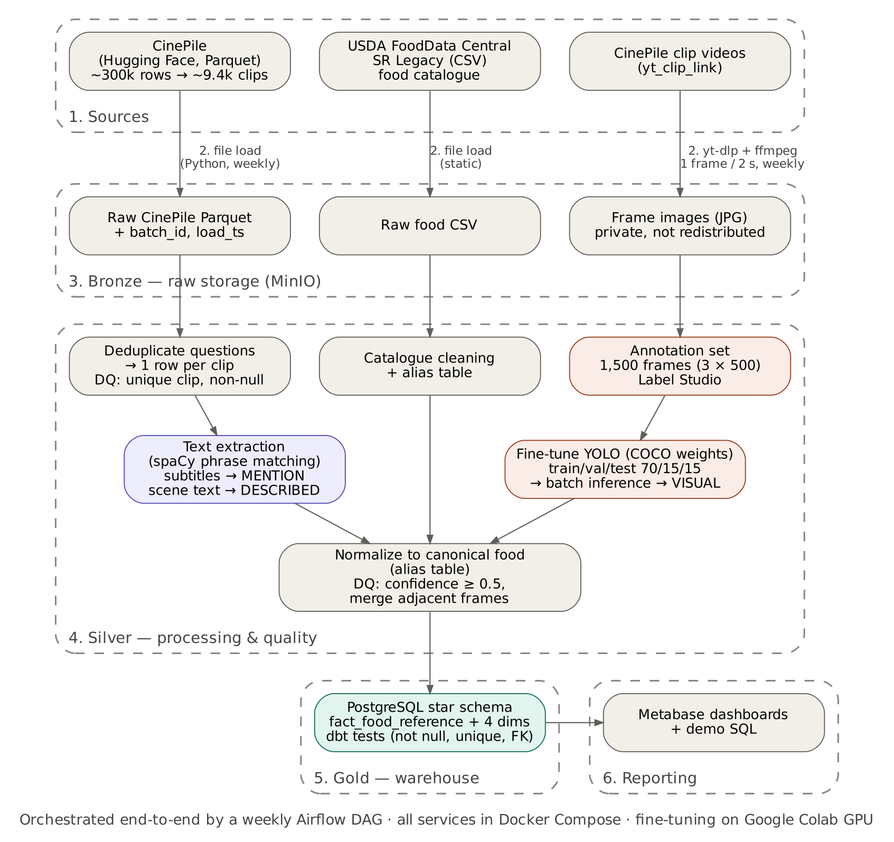
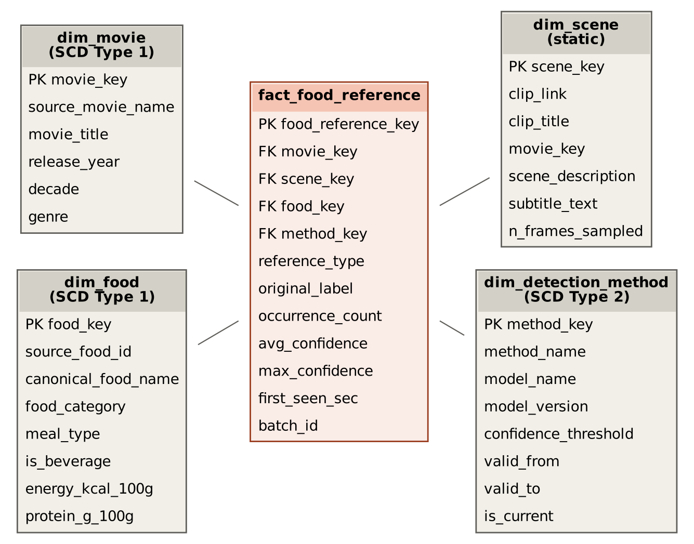

# Tasty Screen

Tasty Screen is a data-modeling project for analyzing food references in movies. It brings together food mentioned in subtitles, described in scenes, and detected in video frames within a PostgreSQL star schema.

This repository currently contains the database schema, illustrative sample data, and analytical SQL queries created for the Data Architecture & Modeling project.

📄 **Report:** [`report/Report.pdf`](report/Report.pdf)

## Repository contents

```text
.
├── README.md
├── docs/
│   ├── architecture.png / .dot 
│   ├── star_schema.png / .dot
│   ├── data_dictionary.md   
├── sql/
|   ├── 01_ddl_star_schema.sql
|   ├── 02_dml_sample_data.sql
|   └── 03_business_queries.sql
└── report/Report.pdf 
```

| File | Description |
|---|---|
| `sql/01_ddl_star_schema.sql` | Creates the PostgreSQL fact and dimension tables, constraints, and indexes |
| `sql/02_dml_sample_data.sql` | Inserts fictional sample records for testing and demonstration |
| `sql/03_business_queries.sql` | Runs seven example analytical queries and one model-version comparison |

## Proposed architecture

The architecture has three paths: CinePile text produces `MENTION` and `DESCRIBED` evidence, the USDA catalogue provides canonical foods and aliases, and clip frames produce `VISUAL` evidence. The paths converge during normalization before loading the analytical model.



- **Bronze** — data exactly as downloaded (CinePile Parquet, SR Legacy CSV, frames), never modified.
- **Silver** — cleaned and processed: one row per clip, food found in text (`MENTION`, `DESCRIBED`) and in frames (`VISUAL`), normalised to canonical foods, with quality checks.
- **Gold** — star schema in PostgreSQL, built and tested with dbt, read by PowerBI.

A weekly **Airflow** DAG runs every step in order. All services run in **Docker Compose**; the detector is fine-tuned on a **Google Colab** GPU.

> Airflow, dbt, visual-model training, and Power BI are proposed parts of the complete platform; this repository currently implements only the SQL model and demonstration queries.

## Data model



The star schema uses `fact_food_reference` as its central table and contains four dimensions:

- `dim_movie`
- `dim_scene`
- `dim_food`
- `dim_detection_method`

**Grain of `fact_food_reference`:** Each fact row represents one canonical food in one scene, for one evidence type and one detection-method version. The supported evidence types are:

- `MENTION` — found in subtitles
- `DESCRIBED` — found in the scene description
- `VISUAL` — detected in video frames

Repeated references at the same grain are stored in `occurrence_count`. Detection methods are versioned so that results remain reproducible when a text matcher or visual model changes.

## Requirements

- PostgreSQL
- The `psql` command-line client

## Running the SQL

### Command line

Create a database and execute the files in order from the repository root:

```bash
createdb tasty_screen
psql -v ON_ERROR_STOP=1 -d tasty_screen -f sql/01_ddl_star_schema.sql
psql -v ON_ERROR_STOP=1 -d tasty_screen -f sql/02_dml_sample_data.sql
psql -v ON_ERROR_STOP=1 -d tasty_screen -f sql/03_business_queries.sql
```

### pgAdmin

The scripts can also be run through the pgAdmin interface:

1. Create a database named `tasty_screen`.
2. Select the database and open **Tools → Query Tool**.
3. Open and execute each SQL file in this order:
   1. `sql/01_ddl_star_schema.sql`
   2. `sql/02_dml_sample_data.sql`
   3. `sql/03_business_queries.sql`

Run each file completely before opening the next one. Query results from the final script appear in pgAdmin's **Data Output** panel.

The DDL script drops and recreates the five model tables. Do not run it against a database containing data you need to preserve.

The sample rows are fictional and exist only to demonstrate the schema and produce results from the example queries.

## Business Questions

The queries examine:

1. Food categories most often shown on screen
2. Foods most often mentioned in dialogue
3. Foods both mentioned and shown in the same scene
4. Food-reference rates by movie genre
5. Food categories appearing across the widest range of genres
6. Movies containing the most food references
7. Visual appearances of beverages compared with solid food

An additional query compares results produced by different detector versions.

## Data sources

The proposed full platform uses:

- [CinePile](https://huggingface.co/datasets/tomg-group-umd/cinepile) for movie, clip, subtitle, and scene-description data
- [USDA FoodData Central — SR Legacy](https://fdc.nal.usda.gov/download-datasets) as the canonical food catalogue
- A group-created frame-annotation set for the proposed visual food detector

Source datasets and movie frames are not included in this repository.

## Building the food detector 
We do not train a model from scratch. We fine-tune a YOLO detector that is already pre-trained on COCO (which already knows 10 food classes such as pizza, sandwich and cake, plus cups, bottles and wine glasses), so 1,500 annotated frames are enough.

1. Frame selection. 1,500 frames from clips where the text branch found food, spread across genres, plus ≈15% frames without food (negatives).
2. Pre-annotation. The COCO model proposes boxes automatically; annotators only correct them and add missing classes, which cuts labelling time to roughly 30–60 s per frame (≈4–8 h per member).
3. Annotation. Each member labels 500 frames in Label Studio with 13 classes: pizza, burger/sandwich, hot dog, fries, salad/vegetables, fruit, bread/pastry, cake/dessert, meat dish, pasta/noodles, hot drink, alcoholic drink, soft drink/bottle. Classes with too few examples are merged into a broader category.
4. Quality control. 50 frames are labelled by all three members to measure inter-annotator agreement (boxes matching at Intersection over Union ≥ 0.5), following a shared labelling guide.
5. Split. 70/15/15 train/validation/test, split by clip rather than by frame, because consecutive frames of a clip are almost identical and would leak into the test set.
6. Fine-tuning and evaluation. Ultralytics YOLO on a Google Colab GPU (around one hour). We report mAP@0.5 and per-class precision on the test set and choose the confidence threshold from it.
7. Inference. The registered model version is applied to all sampled frames; every result carries its model_version (see dim_detection_method).
    
To avoid biasing visual statistics towards clips that already mention food, inference also runs on a random control sample of clips.

## Team

| Member | Contribution |
|---|---|
| Xchel RICO VILLA | 33% |
| Bao Huy TRAN | 33% |
| Mohamad CHEHAB | 33% |
